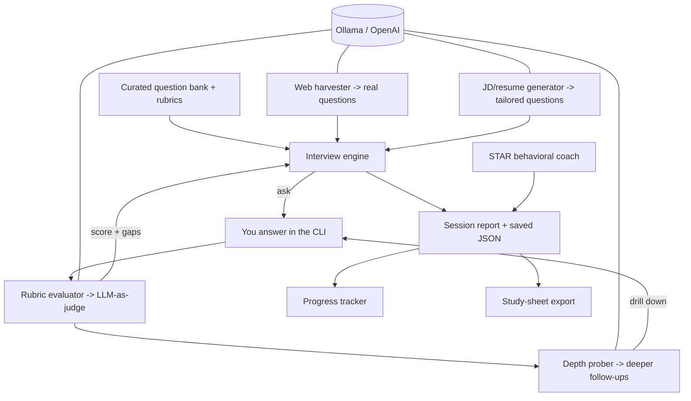

# 🎤 AI Interviewer — Mock Interview Coach for AI Engineer / FDE roles

An interactive, **local-first mock interviewer** that asks real AI Engineer /
Forward Deployed Engineer questions, evaluates your answers against a rubric,
asks adaptive follow-ups like a real interviewer, and tracks your weak areas
across sessions so you know exactly what to study.

Runs on **local models via Ollama** by default, so practicing is unlimited and
free. Built to prep for real interviews in a couple of weeks.

---

## What it does

- **Harvests real questions from the web** — scans India-focused sources
  (AmbitionBox, Glassdoor India) and 2026 AI-eng guides, uses the LLM to extract
  actual asked questions and auto-generate rubrics, then feeds them into the mock.
- **Asks** curated questions across the topics that AI Eng / FDE interviews
  actually cover: LLM fundamentals, RAG, agents, evaluation, system design,
  production, and client-facing (FDE) behavioral scenarios.
- **Evaluates** each answer against an expert rubric and returns a 0-10 score,
  what you covered, what you missed, factual errors, and a tight model answer.
- **Follows up** adaptively with **depth-probing chains**: it reads your actual
  answer, targets the vaguest or least-supported part, and keeps drilling ("but
  why?", "what breaks at scale?", "how did you measure that?") several levels
  deep, exactly like a real interviewer finding the edge of your knowledge.
- **Reports** an overall verdict, per-category scores, and your biggest gaps.
- **Tracks progress** across every session so you can watch yourself improve.

## Quickstart

```bash
pip install -r requirements.txt

# make sure Ollama is running with a model
ollama serve
ollama pull qwen2.5:7b        # default judge model (recommended)

# 1. harvest real interview questions from the web (India-focused)
python -m interviewer.harvester --max-pages 6

# 2. run a mock interview that includes those real questions
python -m interviewer.cli --web

# focus a weak area / difficulty
python -m interviewer.cli --category RAG --n 4
python -m interviewer.cli --difficulty hard

# see your progress across all past sessions
python -m interviewer.progress
```

### Web harvester
```bash
# default India-focused searches (AmbitionBox, Glassdoor India, 2026 guides)
python -m interviewer.harvester --max-pages 8

# custom, targeted searches
python -m interviewer.harvester --query "Forward Deployed Engineer interview India" \
                                --query "Palantir FDE interview questions"

# start a fresh bank instead of appending
python -m interviewer.harvester --fresh
```

Harvested questions are saved to `data/harvested_questions.json` (deduped, with
auto-generated rubrics and source URLs) and merged into the interview when you
pass `--web`.

### JD- and resume-aware questions

Generate questions tailored to a specific job description and your resume. These
drill into the exact projects/claims on your resume and the skills the JD
demands, which is exactly how real interviewers test whether your experience is
as deep as you claim.

```bash
# from files
python -m interviewer.jd_generator --jd jd.txt --resume resume.txt --n 8

# inline
python -m interviewer.jd_generator --jd-text "Forward Deployed AI Engineer, RAG, agents..." --n 6

# then practice ONLY those tailored questions
python -m interviewer.cli --tailored

# or mix them into a normal mock
python -m interviewer.cli --with-tailored --web
```

Answer prompts are multi-line: type your answer, then an empty line + Enter to
submit. Type `skip` to skip a question.

### STAR behavioral coach

A dedicated behavioral round scored on the **STAR** framework (Situation, Task,
Action, Result), the structure top companies expect. It flags which STAR parts
you missed and rewrites a tighter version so you learn the shape of a great
answer.

```bash
python -m interviewer.star            # 4 behavioral questions
python -m interviewer.star --n 6 --voice
```

### Study-sheet export

Turn your weak spots into a focused revision cheat-sheet. Reads all your past
sessions, ranks your weakest categories, lists the rubric points you keep
missing, synthesizes crisp revision notes, and collects the model answers you
were shown.

```bash
python -m interviewer.studysheet              # -> study_sheet.md
python -m interviewer.studysheet --no-llm     # faster, no synthesis
```

## Better evaluation quality

The default judge is `qwen2.5:7b`, which scores well-calibrated (harsh on vague
answers, fair on strong ones). A smaller model like `llama3.2` runs faster but
is a more lenient judge:

```bash
INTERVIEWER_MODEL=llama3.2:latest python -m interviewer.cli   # faster, rougher
```

Or use a hosted model:

```bash
export OPENAI_API_KEY=sk-...
INTERVIEWER_BACKEND=openai INTERVIEWER_MODEL=gpt-4o-mini python -m interviewer.cli
```

## Options

| Flag | Meaning |
|---|---|
| `--n N` | number of questions (default 6) |
| `--category C` | restrict to one category (LLM Fundamentals, RAG, Agents, Evaluation, System Design, Forward Deployed, Coding) |
| `--difficulty D` | easy / medium / hard |
| `--no-followups` | disable adaptive follow-up questions |
| `--probe-depth N` | depth-probing follow-ups per question (default 2) |
| `--voice` | speak the questions aloud (macOS `say`) |
| `--seed N` | deterministic question selection |

## Architecture



- `interviewer/llm.py` — model client (Ollama default; OpenAI optional) with a
  robust JSON extractor + native `format=json` for reliable structured output.
- `interviewer/questions.py` — curated question bank + loaders that merge
  web-harvested and JD-tailored questions.
- `interviewer/evaluator.py` — rubric-based LLM-as-judge (score, covered/missed,
  factual errors, model answer) with clamping, non-answer handling, and fallbacks.
- `interviewer/prober.py` — depth-probing follow-up generator (drills into your
  actual answer, several levels deep).
- `interviewer/engine.py` — question selection, probe orchestration, reporting.
- `interviewer/cli.py` — interactive terminal UI (rich) + session persistence.
- `interviewer/harvester.py` — web scraper: search + fetch + LLM extraction of
  real interview questions with auto-rubrics (India-focused seeds + fallback).
- `interviewer/jd_generator.py` — JD/resume-aware tailored question generator.
- `interviewer/star_coach.py` + `interviewer/star.py` — STAR behavioral coach.
- `interviewer/studysheet.py` — revision cheat-sheet export.
- `interviewer/progress.py` — cross-session analytics and trend.
- `tests/` — 18 offline tests (mock LLM, no Ollama needed).

## Tests

```bash
python tests/test_interviewer.py     # 18/18, runs offline
```

## Known issues & workarounds

See [`FALLBACKS.md`](FALLBACKS.md) for the full log of problems hit while building
this (search rate-limiting, small-model JSON reliability, crash-safe harvesting,
etc.) and how each was resolved.

## Roadmap
- Voice answers (speech-to-text) for a fully spoken mock interview
- Company-specific question packs
- Timed / pressure mode with per-question countdown
- Spaced repetition across sessions for weakest topics
