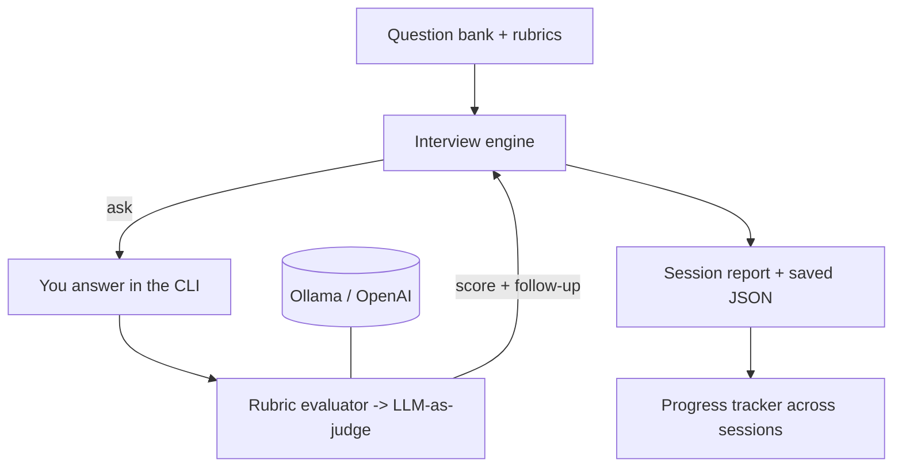

# 🎤 AI Interviewer — Mock Interview Coach for AI Engineer / FDE roles

An interactive, **local-first mock interviewer** that asks real AI Engineer /
Forward Deployed Engineer questions, evaluates your answers against a rubric,
asks adaptive follow-ups like a real interviewer, and tracks your weak areas
across sessions so you know exactly what to study.

Runs on **local models via Ollama** by default, so practicing is unlimited and
free. Built to prep for real interviews in a couple of weeks.

---

## What it does

- **Asks** curated questions across the topics that AI Eng / FDE interviews
  actually cover: LLM fundamentals, RAG, agents, evaluation, system design,
  production, and client-facing (FDE) behavioral scenarios.
- **Evaluates** each answer against an expert rubric and returns a 0-10 score,
  what you covered, what you missed, factual errors, and a tight model answer.
- **Follows up** adaptively: if your answer is decent, it probes deeper, exactly
  like a real interviewer testing the edge of your knowledge.
- **Reports** an overall verdict, per-category scores, and your biggest gaps.
- **Tracks progress** across every session so you can watch yourself improve.

## Quickstart

```bash
pip install -r requirements.txt

# make sure Ollama is running with a model
ollama serve
ollama pull llama3.2          # works out of the box

# run a mock interview
python -m interviewer.cli

# focus a weak area
python -m interviewer.cli --category RAG --n 4
python -m interviewer.cli --difficulty hard

# see your progress across all past sessions
python -m interviewer.progress
```

Answer prompts are multi-line: type your answer, then an empty line + Enter to
submit. Type `skip` to skip a question.

## Better evaluation quality

`llama3.2` (3B) works but is a lenient/rough judge. For sharper, more reliable
scoring pull a stronger local model:

```bash
ollama pull qwen2.5:7b
INTERVIEWER_MODEL=qwen2.5:7b python -m interviewer.cli
```

Or use a hosted model:

```bash
export OPENAI_API_KEY=sk-...
INTERVIEWER_BACKEND=openai INTERVIEWER_MODEL=gpt-4o-mini python -m interviewer.cli
```

## Options

| Flag | Meaning |
|---|---|
| `--n N` | number of questions (default 6) |
| `--category C` | restrict to one category (LLM Fundamentals, RAG, Agents, Evaluation, System Design, Forward Deployed, Coding) |
| `--difficulty D` | easy / medium / hard |
| `--no-followups` | disable adaptive follow-up questions |
| `--voice` | speak the questions aloud (macOS `say`) |
| `--seed N` | deterministic question selection |

## Architecture



- `interviewer/questions.py` — curated question bank, each with a scoring rubric.
- `interviewer/llm.py` — model client (Ollama default; OpenAI optional) with a
  robust JSON extractor for structured evaluation from small local models.
- `interviewer/evaluator.py` — rubric-based LLM-as-judge with score clamping and
  graceful fallbacks.
- `interviewer/engine.py` — question selection, follow-up logic, report aggregation.
- `interviewer/cli.py` — interactive terminal UI (rich) + session persistence.
- `interviewer/progress.py` — cross-session analytics and trend.
- `tests/` — 9 offline tests (mock LLM, no Ollama needed).

## Tests

```bash
python tests/test_interviewer.py     # 9/9, runs offline
```

## Roadmap
- Voice answers (speech-to-text) for a fully spoken mock interview
- Resume-aware questions (paste your resume, get tailored probing)
- Company-specific question packs
- Timed mode + "thinking out loud" coaching
